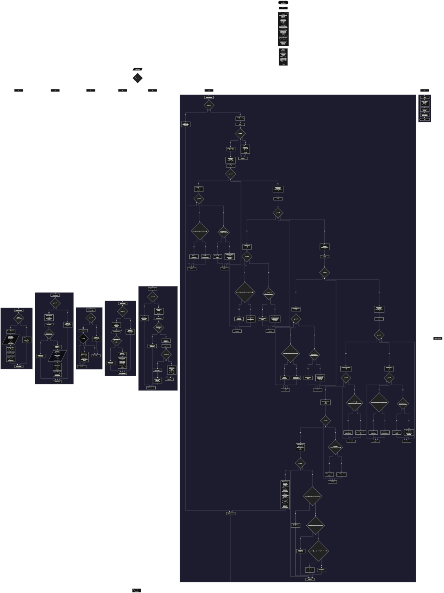

Este proyecto, llamado <b>azulejos geométricos</b>, fue desarrollado en <b>java</b> como un ejercicio práctico para fortalecer la lógica de programación mediante la creación de un sistema de gestión de modelos de azulejos desde la consola. El programa cuenta con un menú principal de siete opciones que permite <b>registrar, editar, listar, buscar, eliminar y consultar un resumen</b> de los azulejos registrados. Cada modelo almacena información como el código, nombre del diseño, forma geométrica, material, dimensiones, color, patrón, cantidad de piezas, precio por pieza y estado, utilizando arreglos con una capacidad máxima de <b>10 modelos durante la ejecución</b>. Durante su desarrollo se aplicaron conceptos fundamentales de programación, como variables, arreglos, estructuras condicionales, ciclos repetitivos y estructuras de selección, además de procesos para buscar, modificar, eliminar y analizar los registros almacenados. Este proyecto permite poner en práctica los conocimientos adquiridos en java y sirve como base para desarrollar sistemas de gestión de inventarios más avanzados.

<h2 align="center">⚙️ Funcionamiento del menú principal</h2>

### ➕ Registrar azulejo

La opción <b>1) registrar azulejo</b> permite almacenar un nuevo modelo de azulejo en el sistema. Antes de realizar el registro, el programa comprueba que la cantidad de modelos almacenados sea menor a la capacidad del arreglo <b>codigos</b>, utilizando la condición <b>total &gt;= codigos.length</b> para identificar si se alcanzó el límite de almacenamiento. Si no existe espacio disponible, muestra el mensaje <b>"no hay espacio para registrar mas azulejos."</b> e impide continuar con el registro. En caso contrario, presenta el identificador del nuevo modelo mediante la expresión <b>total + 1</b> y solicita los siguientes datos: <b>código, nombre del diseño, forma geométrica, material, largo, ancho, color, patrón, cantidad de piezas, precio por pieza y estado</b>. La información se almacena en la posición correspondiente de sus respectivos arreglos. Finalmente, incrementa la variable <b>total</b> en uno y muestra el mensaje <b>"azulejo registrado correctamente."</b>.

### ✏️ Editar azulejo

La opción <b>2) editar azulejo</b> permite modificar la información de un modelo registrado. Primero, el programa comprueba si existen azulejos almacenados mediante la variable <b>total</b>. Si no hay registros, muestra el mensaje <b>"no existen azulejos registrados."</b>. En caso contrario, presenta una lista con el ID, código, nombre, forma, material, largo, ancho, color, patrón, cantidad, precio y estado de cada modelo. Después, solicita el ID del azulejo que se desea editar y comprueba que esté dentro del rango permitido mediante la condición <b>idEditar &gt;= 1 &amp;&amp; idEditar &lt;= total</b>. Si la selección es válida, calcula la posición correspondiente mediante <b>posicion = idEditar - 1</b> y solicita nuevamente todos los datos del modelo, actualizando directamente los valores de los arreglos correspondientes. Finalmente, presenta el mensaje <b>"azulejo actualizado correctamente."</b>. Si el ID seleccionado no corresponde a un modelo registrado, muestra el mensaje <b>"ID no encontrada."</b>.

### 📋 Listar azulejos

La opción <b>3) listar azulejos</b> permite visualizar todos los modelos registrados actualmente en el sistema. Antes de mostrar la información, el programa comprueba si la variable <b>total</b> es igual a cero. Si no existen registros, presenta el mensaje <b>"no existen azulejos registrados."</b>. Si hay modelos disponibles, muestra el encabezado <b>"lista de azulejos"</b> y utiliza un ciclo <b>for</b> para recorrer los arreglos desde la primera posición hasta el número total de modelos registrados. Durante el recorrido, muestra el ID, código, nombre del diseño, forma geométrica, material, largo, ancho, color, patrón, cantidad de piezas, precio por pieza y estado de cada azulejo. Esta función facilita consultar los modelos almacenados sin necesidad de buscar cada registro individualmente.

### 🔎 Buscar azulejo

La opción <b>4) buscar azulejo</b> permite localizar un modelo mediante su identificador. Primero, el programa comprueba si existen azulejos registrados. Si el sistema está vacío, muestra el mensaje <b>"no existen azulejos registrados."</b>. En caso contrario, presenta el encabezado <b>"busqueda de azulejo"</b> y solicita el ID del modelo que se desea buscar. A continuación, comprueba que el identificador introducido esté dentro del rango permitido mediante la condición <b>idBusqueda &gt;= 1 &amp;&amp; idBusqueda &lt;= total</b>. Si el ID es válido, obtiene la posición correspondiente mediante <b>posicion = idBusqueda - 1</b> y muestra todos los datos del azulejo encontrado: código, nombre, forma, material, largo, ancho, color, patrón, cantidad, precio y estado. Si el identificador no corresponde a un modelo registrado, presenta el mensaje <b>"ID no encontrada."</b>. La búsqueda se realiza mediante el acceso directo a la posición del arreglo correspondiente al ID introducido.

### 🗑️ Eliminar azulejo

La opción <b>5) eliminar azulejo</b> permite eliminar un modelo registrado mediante su identificador. Antes de comenzar, el programa comprueba que existan azulejos almacenados. Si no hay registros, muestra el mensaje <b>"no existen azulejos registrados."</b>. Si existen modelos disponibles, presenta una lista con los datos de cada azulejo para facilitar su identificación. Después, solicita el ID del modelo que se desea eliminar y verifica que esté dentro del rango permitido mediante la condición <b>idEliminar &gt;= 1 &amp;&amp; idEliminar &lt;= total</b>. Si el identificador es válido, obtiene la posición correspondiente mediante <b>posicion = idEliminar - 1</b> y comienza el proceso de eliminación. Para mantener organizados los registros, utiliza un ciclo <b>for</b> controlado por la variable <b>i</b>, que desplaza una posición hacia atrás los datos de los modelos posteriores en los once arreglos: <b>codigos, nombres, formas, materiales, largos, anchos, colores, patrones, cantidades, precios y estados</b>. Posteriormente, disminuye la variable <b>total</b> en uno y muestra el mensaje <b>"azulejo eliminado correctamente."</b>. Si el ID seleccionado no corresponde a un modelo registrado, presenta el mensaje <b>"ID no encontrada."</b>.

### 📊 Mostrar resumen

La opción <b>6) mostrar resumen</b> permite consultar información estadística de los modelos registrados. Primero, el programa comprueba si existen azulejos almacenados. Si el sistema está vacío, muestra el mensaje <b>"no existen azulejos registrados."</b>. En caso contrario, inicializa las variables necesarias para realizar diferentes cálculos. Mediante un ciclo <b>for</b>, acumula la cantidad total de piezas utilizando <b>totalPiezas</b> y suma los precios de cada modelo mediante <b>sumaPrecios</b>. Después, calcula el precio promedio utilizando la expresión <b>precioPromedio = sumaPrecios / total</b>.

También realiza cuatro análisis de frecuencia mediante ciclos <b>for</b> anidados, identificando la forma geométrica, el material, el color y el patrón que aparecen con mayor frecuencia. Para ello, utiliza las variables <b>formaMayor, materialMayor, colorMayor y patronMayor</b>, junto con sus respectivos contadores. Las comparaciones se realizan mediante el método <b>equalsIgnoreCase()</b>, que permite identificar coincidencias sin distinguir entre mayúsculas y minúsculas.

Posteriormente, utiliza recorridos para identificar el modelo con mayor cantidad de piezas y el modelo con el precio por pieza más elevado, almacenando sus posiciones en <b>posicionMayorCantidad</b> y <b>posicionMayorPrecio</b>. Finalmente, contabiliza los modelos según sus estados mediante las variables <b>disponibles, agotados y descontinuados</b>, comparando cada registro con los valores <b>"Disponible", "Agotado" y "Descontinuado"</b>. Al terminar los cálculos, muestra el total de modelos registrados, las piezas almacenadas, las características más utilizadas, los modelos con los valores máximos, el precio promedio y la cantidad de modelos correspondientes a cada estado.

### 🚪 Salir del menú principal

La opción <b>7) salir</b> está destinada a finalizar la ejecución del programa y muestra el mensaje <b>"gracias por utilizar Azulejos Geometricos."</b>. El menú principal se encuentra dentro de una estructura repetitiva <b>do-while</b>, que mantiene el programa en funcionamiento mientras la variable <b>opcion</b> sea diferente de <b>7</b>. Cuando el usuario selecciona esta opción, el ciclo termina y el programa ejecuta <b>entrada.close()</b> para cerrar el objeto <b>Scanner</b> utilizado durante la captura de información.

<h2 align="center">🧠 Temas aplicados en el proyecto</h2>

### 📦 Variables

En este proyecto se utilizan variables para almacenar la opción seleccionada en el menú, controlar la cantidad de modelos registrados, identificar las posiciones de los azulejos, guardar los identificadores utilizados en las operaciones y realizar los cálculos estadísticos del resumen. También se emplean variables auxiliares para acumular cantidades y precios, contar las características más frecuentes, identificar los valores máximos y clasificar los modelos según sus estados. Cada variable cumple una función específica dentro de las operaciones de gestión de azulejos.

🔢 **Opcion:** Almacena la opción seleccionada por el usuario en el menú principal.

📊 **Total:** Controla la cantidad actual de modelos registrados.

🔄 **I:** Funciona como contador en los ciclos `for` y permite recorrer las posiciones de los arreglos.

🔁 **J:** Controla los recorridos internos de los ciclos anidados utilizados para calcular las frecuencias de formas, materiales, colores y patrones.

📝 **IdEditar:** Almacena el identificador del modelo que se desea modificar.

🔎 **IdBusqueda:** Almacena el identificador del modelo que se desea buscar.

🗑️ **IdEliminar:** Almacena el identificador del modelo que se desea eliminar.

📍 **Posicion:** Identifica la posición del arreglo correspondiente al ID seleccionado durante las operaciones de edición, búsqueda y eliminación.

📦 **TotalPiezas:** Acumula la cantidad de piezas de todos los modelos registrados.

💰 **SumaPrecios:** Acumula los precios por pieza de los modelos almacenados.

📊 **PrecioPromedio:** Almacena el resultado de dividir la suma de los precios entre el total de modelos registrados.

🔷 **FormaMayor, MaterialMayor, ColorMayor y PatronMayor:** Almacenan las características que presentan la mayor frecuencia dentro de los registros.

🔢 **CantidadFormaMayor, CantidadMaterialMayor, CantidadColorMayor y CantidadPatronMayor:** Almacenan las frecuencias máximas encontradas para cada característica.

📈 **PosicionMayorCantidad:** Almacena la posición del modelo que tiene la mayor cantidad de piezas.

💲 **PosicionMayorPrecio:** Almacena la posición del modelo que tiene el precio por pieza más elevado.

📊 **Disponibles, Agotados y Descontinuados:** Cuentan los modelos registrados según su estado.

### 🗃️ Arreglos

En este proyecto se utilizan once arreglos relacionados con los datos de cada modelo de azulejo. Cada arreglo tiene una capacidad de <b>10 posiciones</b> y utiliza el mismo índice para representar la información correspondiente a un mismo modelo. Por ejemplo, los datos de un azulejo almacenado en la posición <b>0</b> se encuentran distribuidos entre <b>codigos[0], nombres[0], formas[0], materiales[0], largos[0], anchos[0], colores[0], patrones[0], cantidades[0], precios[0] y estados[0]</b>. Esta organización permite registrar, recorrer, buscar, modificar, mostrar, eliminar y analizar los modelos de manera ordenada.

🔖 **Codigos[10]:** Almacena los códigos de identificación de los modelos de azulejos.

📝 **Nombres[10]:** Almacena los nombres de los diseños de los azulejos.

🔷 **Formas[10]:** Almacena las formas geométricas de los modelos registrados.

🧱 **Materiales[10]:** Almacena los materiales utilizados en la fabricación de los azulejos.

📏 **Largos[10]:** Almacena las medidas de largo de los modelos en centímetros.

📐 **Anchos[10]:** Almacena las medidas de ancho de los modelos en centímetros.

🎨 **Colores[10]:** Almacena los colores correspondientes a cada modelo.

🔳 **Patrones[10]:** Almacena los patrones de diseño de los azulejos.

📦 **Cantidades[10]:** Almacena la cantidad de piezas correspondientes a cada modelo.

💰 **Precios[10]:** Almacena los precios por pieza de los modelos registrados.

📊 **Estados[10]:** Almacena los estados de los modelos, como disponible, agotado o descontinuado.

### 🔀 Estructuras condicionales

En este proyecto se utilizan las estructuras <b>if</b>, <b>else if</b> y <b>else</b> para controlar las diferentes operaciones del sistema. Estas condiciones permiten comprobar si existe espacio disponible antes de registrar un azulejo, verificar si hay modelos almacenados antes de ejecutar determinadas operaciones, validar los identificadores utilizados para editar, buscar y eliminar registros, y determinar si las características de los modelos coinciden durante los análisis estadísticos. También permiten clasificar los registros según sus estados y mostrar los mensajes correspondientes dependiendo del resultado de cada comprobación.

### 🔄 Estructuras repetitivas

En este proyecto se utilizan los ciclos <b>for</b> y <b>do-while</b>. Los ciclos <b>for</b> permiten recorrer los arreglos para mostrar los modelos registrados, consultar sus datos y localizar las posiciones correspondientes a cada operación. También se utilizan ciclos <b>for</b> anidados para comparar las formas, materiales, colores y patrones de todos los modelos, calcular sus frecuencias y determinar cuáles son los más utilizados. Durante la eliminación, otro ciclo <b>for</b> permite desplazar los datos de los registros posteriores una posición hacia atrás. Por otro lado, el ciclo <b>do-while</b> mantiene activo el menú principal y permite ejecutar diferentes operaciones hasta que el usuario selecciona la opción <b>7</b>.

### 🎯 Estructura switch

El programa utiliza la estructura <b>switch</b> para evaluar el valor almacenado en la variable <b>opcion</b> y ejecutar el bloque de instrucciones correspondiente. Cada caso representa una operación específica del sistema: <b>registrar, editar, listar, buscar, eliminar, mostrar resumen o salir</b>. También se utiliza el bloque <b>default</b> para mostrar el mensaje <b>"opcion no valida."</b> cuando el usuario introduce un número que no coincide con ninguna de las opciones definidas en el menú. Esta estructura permite organizar las operaciones de manera clara y facilitar la navegación por el sistema.

### 🔢 Dimensionamiento de arreglos

El programa utiliza la creación de arreglos mediante la instrucción <b>new</b> para establecer la capacidad de almacenamiento de los datos de cada modelo de azulejo. Se definieron <b>10 posiciones</b> para cada uno de los once arreglos, lo que permite administrar hasta diez modelos durante la ejecución. La cantidad de posiciones ocupadas se controla mediante la variable <b>total</b>, mientras que la capacidad máxima se comprueba utilizando <b>codigos.length</b>. De esta manera, las operaciones recorren únicamente los registros comprendidos entre la primera posición y el total actual de modelos almacenados.

### 🔄 Reorganización de registros

Cuando se selecciona un azulejo para eliminarlo, el programa utiliza un ciclo <b>for</b> que comienza en la posición seleccionada y continúa hasta <b>total - 1</b>. En cada repetición, los datos de la posición siguiente se copian sobre la posición actual en los once arreglos: <b>codigos, nombres, formas, materiales, largos, anchos, colores, patrones, cantidades, precios y estados</b>. Después, la variable <b>total</b> disminuye en uno. De esta manera, los modelos posteriores ocupan las posiciones anteriores y se mantiene la continuidad de los registros activos. El programa no limpia explícitamente la última posición que queda libre después del desplazamiento.

<h2 align="center">¿Cómo se implementaron las operaciones crud en el proyecto?</h2>

Las operaciones <b>crud</b> se implementaron mediante las opciones del menú principal, permitiendo administrar los modelos de azulejos registrados. La operación <b>crear</b> corresponde a <b>registrar azulejo</b>, donde se introducen los datos de un nuevo modelo; <b>leer</b> se realiza mediante las opciones <b>buscar azulejo, listar azulejos y mostrar resumen</b>, que permiten consultar registros y analizar la información almacenada; <b>actualizar</b> corresponde a <b>editar azulejo</b>, donde se modifican los datos de un modelo existente; y <b>eliminar</b> se realiza mediante la opción <b>eliminar azulejo</b>, que desplaza los registros posteriores para mantener organizadas las posiciones de los arreglos. Estas operaciones utilizan variables, arreglos, condicionales y ciclos para gestionar la información almacenada temporalmente durante la ejecución del programa.

<h2 align="center">Diagrama de flujo del proyecto</h2>

<h2 align="center">🛡️ Validaciones del programa</h2>

### 📭 No existen azulejos registrados

Esta validación se utiliza en las opciones de <b>editar, listar, buscar, eliminar y mostrar resumen</b>. El programa comprueba si la variable <b>total</b> es igual a <b>0</b> y, si no existen modelos registrados, muestra el mensaje <b>"no existen azulejos registrados."</b>. Esta comprobación evita continuar con las operaciones que necesitan información almacenada cuando el sistema se encuentra vacío.

### ⚠️ Capacidad máxima de almacenamiento

Esta validación se utiliza durante el registro de nuevos modelos para controlar la capacidad máxima de los arreglos. El programa comprueba si la variable <b>total</b> es mayor o igual a la longitud del arreglo <b>codigos</b>, mediante la condición <b>total &gt;= codigos.length</b>. Si todavía existe espacio disponible, permite introducir los datos del nuevo azulejo. En caso contrario, muestra el mensaje <b>"no hay espacio para registrar mas azulejos."</b>, impidiendo almacenar más modelos cuando se alcanza el límite de diez posiciones.

### ❌ ID no encontrada

Esta validación se utiliza durante las operaciones de <b>editar, buscar y eliminar azulejo</b>. El programa comprueba que el identificador introducido sea mayor o igual a <b>1</b> y menor o igual al valor de <b>total</b>. Si el ID se encuentra dentro del rango permitido, calcula su posición correspondiente mediante la expresión <b>posicion = id - 1</b> y ejecuta la operación solicitada. Si el identificador está fuera del rango de modelos registrados, muestra el mensaje <b>"ID no encontrada."</b>. Esta comprobación evita acceder a posiciones que no corresponden a registros activos.

### 🔢 Comparación de características y estados

El programa utiliza el método <b>equalsIgnoreCase()</b> para comparar las características y los estados almacenados en los arreglos. Esta comparación permite identificar coincidencias entre las formas geométricas, materiales, colores y patrones sin distinguir entre letras mayúsculas y minúsculas. También se utiliza para clasificar los modelos como <b>"Disponible", "Agotado" y "Descontinuado"</b>. Los estados que no coinciden con estas tres categorías no se contabilizan en ninguno de los contadores del resumen.

### ⚠️ Opción no válida

La estructura <b>switch</b> incluye el bloque <b>default</b>, que muestra el mensaje <b>"opcion no valida."</b> cuando el usuario introduce un número que no corresponde a ninguna de las siete opciones definidas en el menú principal. Esta condición permite informar cuando se selecciona una opción que no está contemplada dentro de las operaciones del sistema.

<h2 align="center">🎯 Objetivo del proyecto</h2>

El objetivo principal de este proyecto es fortalecer la <b>lógica de programación</b> mediante el desarrollo de un sistema de gestión de azulejos geométricos en <b>java</b>. A través de su construcción se busca aplicar los conocimientos adquiridos sobre variables, arreglos, estructuras condicionales, ciclos repetitivos y estructuras de selección, integrándolos para resolver un problema de administración de inventario de manera organizada. Además, el proyecto permite comprender cómo registrar, consultar, modificar y eliminar información, así como realizar cálculos estadísticos para analizar las características, cantidades, precios y estados de los modelos almacenados, estableciendo una base para desarrollar sistemas de gestión más completos con otros lenguajes y tecnologías.

